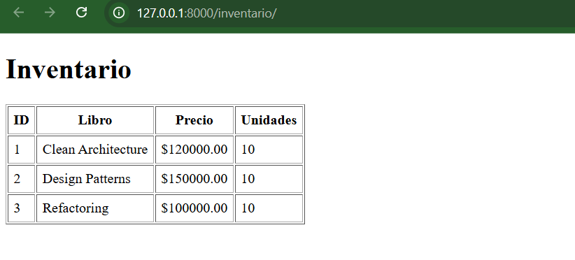
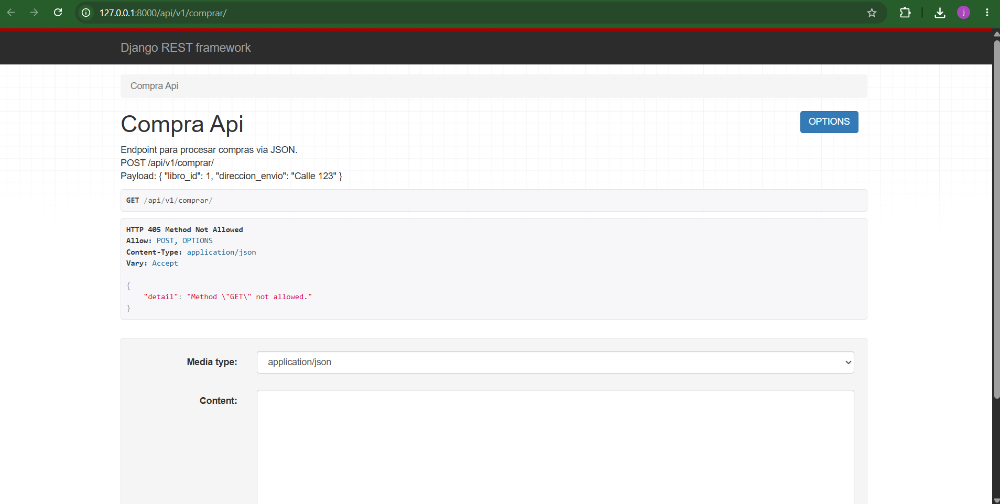
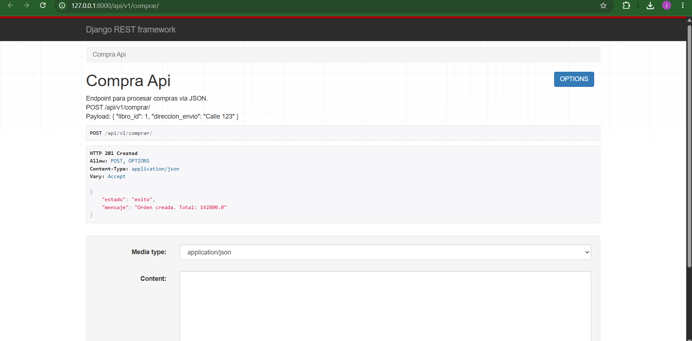
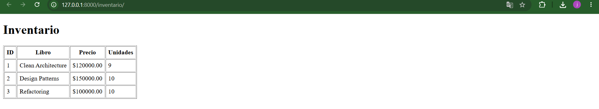

# Tutorial 03 - API REST con Django Rest Framework

Arquitectura de Software 2026 - EAFIT
Jeronimo Carvajal Zuluaga

Se agrega una API REST con DRF que reutiliza la misma capa de servicio (`CompraService`) que usan las vistas HTML. La idea es que las dos "puertas" (HTML y API) llegan a la misma logica de negocio.

## Que se agrego

| Archivo | Que hace |
|---|---|
| `tienda_app/api/serializers.py` | `LibroSerializer` (modelo a JSON) y `OrdenInputSerializer` (valida el JSON de entrada, actua como DTO / Adapter) |
| `tienda_app/api/views.py` | `CompraAPIView`: valida con el serializer, pide el procesador a la `PaymentFactory` y llama a `CompraService` |
| `tienda_app/views.py` | `InventarioView`: pagina HTML con el stock, para ver que la compra por API descuenta inventario |

## Endpoints

- `POST /api/v1/comprar/` con el body:
  ```json
  { "libro_id": 1, "direccion_envio": "Calle 10 #43-20, Medellin" }
  ```
  Respuestas: 201 compra creada, 400 datos invalidos, 404 libro no existe, 409 sin stock.
- `GET /inventario/` muestra el inventario en HTML.

## Como correrlo

```
python -m venv venv
venv\Scripts\activate
pip install -r requirements.txt
python manage.py migrate
python manage.py runserver
```

Se puede probar con Postman o entrando en el navegador a http://127.0.0.1:8000/api/v1/comprar/ (interfaz web de DRF).

## Evidencias

Se compro 1 unidad de "Clean Architecture" (libro_id 1) por la API y despues se reviso la vista HTML de inventario.

1. Inventario antes de la compra (todos los libros con 10 unidades):



2. Interfaz web de DRF en `/api/v1/comprar/`. Al abrirla con GET sale 405 porque el endpoint solo acepta POST; abajo esta el formulario para enviar el JSON:



3. Respuesta `201 Created` de la API:



4. Inventario despues de la compra (Clean Architecture paso de 10 a 9):



El pago quedo registrado en `pagos_locales_JERONIMO_CARVAJAL.log`:

```
[2026-10-13 10:19:28.804308] Transaccion exitosa por: $142800.0
```

Esto muestra que las dos "puertas" (HTML y API) llegan a la misma "habitacion" (la logica de negocio en `CompraService`).
